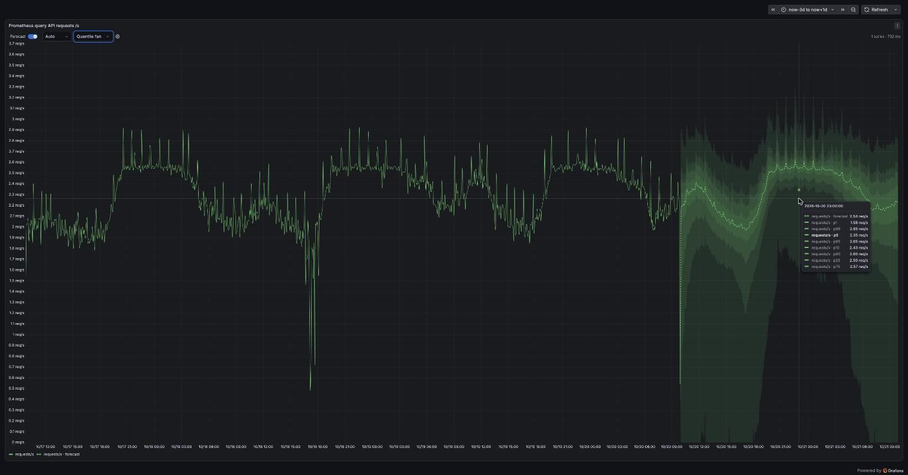

# grafana-timestral



Forecast any time series in Grafana with [Mistral's Timestral](https://mistral.ai/news/timestral/)
model. You don't need to set anything up or train a model.

## Features

- **Forecast panel**: your queries plus a forecast with confidence bands. Pick the horizon and the
  band right in the panel.
- **Forecast any panel or Explore result**: _Forecast with Timestral_ in the panel menu or in
  Explore's _Add_ menu, then add the result to a dashboard.
- **Alerting**: the Timestral data source forecasts any other data source's queries, so you can alert
  on predictions such as _CPU will exceed 80% within 3 hours_.
- **Context-aware forecasts**: use related queries as inputs (e.g. written bytes for disk usage) and
  hour-of-day or day-of-week patterns.
- **Capacity planning**: see when a series is expected to cross a threshold.
- **Backtesting**: check past forecast accuracy and highlight anomalies.

## Install

Download the zip for your platform (e.g. `consi-timestral-app-1.0.0.linux_amd64.zip`) from
[releases](https://github.com/consi/grafana-timestral/releases), unzip it into Grafana's plugins
directory, and allow the unsigned plugin:

```ini
[plugins]
allow_loading_unsigned_plugins = consi-timestral-app,consi-timestral-panel,consi-timestral-datasource
```

Then enable **Timestral** under _Administration → Plugins_ and click **Create data source and service
account**.

Requirements: Grafana 12+, about 1 GB of disk and memory. The plugin runs on the Grafana server's CPU
and needs no GPU or other services.

## Development

```sh
npm ci && npm run build:all         # frontend, model, backend (all platforms)
docker compose up -d                # Grafana with a demo dashboard and alert rule
./scripts/bootstrap-datasource.sh   # creates the Timestral data source
npm run package                     # one zip per platform in artifacts/
```

Set `PROMETHEUS_URL` in `.env` to use your own Prometheus; the default is the public demo server.
Tests: `npm run typecheck && npm run lint && npm run test:ci`, and `go test ./pkg/...` after `npm run build:model`.

## License

Apache-2.0. It includes Mistral AI's Timestral-209M weights under their
[Modified MIT License](https://huggingface.co/mistralai/Timestral-209M/blob/main/LICENSE), which
**does not cover companies with more than USD 20 million in monthly revenue, or their employees**.
See `NOTICE`. Not affiliated with Mistral AI.
